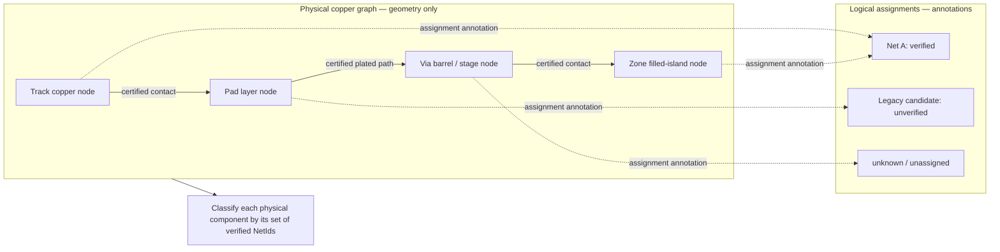
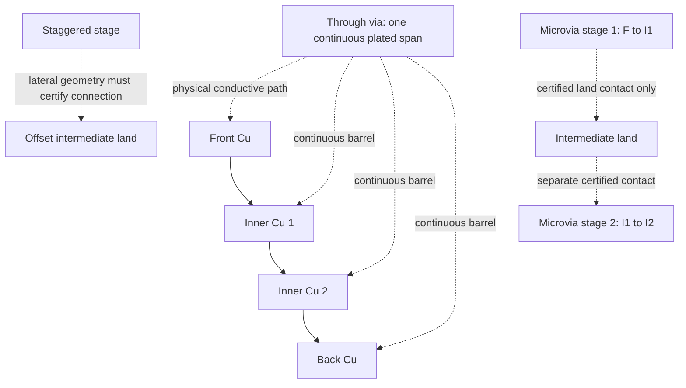

# PCB Studio Pro — Phase 6.0.2 Architecture Corrections

**Purpose:** Design-only correction and design-freeze preparation based on `PHASE_6_0_1_DRC_DATA_MODEL_ARCHITECTURE.md`.

**Status:** Proposal, not implementation authorization. No repository files, tests, configuration, UI, commits, pushes, or branches were changed.

## 1. Isolation and baseline verification

- Repository: `/home/ubuntu/work/repo` (`soheil6913/-PCB-Studio-Pro`).
- Required branch: `implementation/phase6-net-aware-drc-20261120`.
- Current `HEAD`: `6fad0dcdc7e5878e671b8b419b2f61084e5a8138`; this is the required baseline and it is an ancestor of itself.
- Worktree: clean.
- `main`: `de7497a675af7c6212bbc4751fce098c1f414e8d`, unchanged.
- Revised report location: `/home/ubuntu/work/PHASE_6_0_2_ARCHITECTURE_CORRECTIONS.md`, outside the repository.

## 2. Corrections to the Phase 6.0.1 proposal

The revised design makes four changes:

1. **Physical copper connectivity is built independently of logical Net assignment.** All certified conductive contacts enter the physical graph, including objects with unknown or unassigned Net identity. Net labels neither create nor erase physical edges.
2. **Via spans are a discriminated union.** Valid, unknown, and invalid spans are distinct; ordinary through/blind/buried vias are distinct from staged microvia constructions. Microvia stages are not collapsed into a continuous barrel.
3. **Legacy Net migration IDs are deterministic and disjoint from newly generated Net IDs.** Repeated migration of the same v2 source produces the same candidate IDs; candidates remain unverified and cannot trigger same-Net exemptions.
4. **Pads use a Padstack.** Copper geometry is specified per copper layer, hole/plating semantics are explicit, and Pad-to-Component/Pin relations use stable IDs. Unsupported pad configurations remain explicitly unresolved.

These corrections refine the architecture only. They do not imply any of these structures or rules exist in the baseline.

## 3. Current-state source references

At the verified baseline:

- `shared/engineering.ts:3–13`: `Layer` is only `F.Cu | B.Cu`; `EngineeringTrack.net` and `EngineeringWire.net` are optional strings; Via has optional two-layer tuple; Pad has one primary shape/layer plus optional layers/drill/plated; there is no `Net`, `Padstack`, stackup, or Copper Zone collection.
- `shared/engineering.ts:269–284`: `validateSchematic` constructs a schematic wire/junction/pin graph and separately reasons about wire labels. It is not the PCB copper graph.
- `shared/engineering.ts:286–322`: PCB DRC runs pairwise geometrical checks. Track-track is at `:309`, Track-pad / Pad-pad at `:318–319`, track/via/pad and individual Via checks at `:320`, Via-via at `:321`. No PCB Net assignment participates.
- `shared/engineering.ts:321`: Via-via uses 2D center distance. `actual = distance(centerA, centerB)`; `required = radiusA + radiusB + minimumViaClearance`, with radius from `diameter / 2` or `drill` when diameter is absent. It compares all Via pairs without consulting layer spans. This is observed v2 behavior, not an endorsement of multilayer applicability.
- `shared/engineering.ts:330–347`: schema validation rejects unknown fields; Pad drill and plating are limited; Via layers must be exactly two distinct values from `F.Cu`/`B.Cu`; `minimumViaClearance`, `minimumDrillDiameter`, and `minimumAnnularRing` are currently rule fields.
- `shared/phase5_1.geometry-validation.test.ts:359–389` and `shared/engineering.test.ts:156–175`: current accepted explicit Via spans are both outer layers in either array order; missing `layers` is allowed but does not state that spans are disjoint.
- `shared/engineering.test.ts:67–93,149–165`: tests exercise schematic connectivity, not PCB Net connectivity.
- `client/src/pages/Home.tsx:19,42–43,64`: editor-local schematic wire labels are simple strings, including generated demo labels, not registry-backed PCB NetIds.
- `PHASE_5_5_DRC_POLICY_CERTIFICATION.md:38–47,149–160`: prior verification documents absent multilayer spans, unmodeled blind/buried distinction, and pending applicability policy.

## 4. Corrected identity and physical graph model

### 4.1 Logical Net assignment is an annotation, not graph construction

A Net assignment expresses intended logical membership. It does not itself establish contact or connectivity. The physical graph represents the current certified conductive geometry and continuity only.

```ts
type NetId = string & { readonly __brand: "NetId" };
type CopperObjectId = string & { readonly __brand: "CopperObjectId" };
type CopperNodeId = string & { readonly __brand: "CopperNodeId" };
type ContactId = string & { readonly __brand: "ContactId" };

type NetAssignment =
  | { state: "verified"; netId: NetId }
  | { state: "unverified"; candidateNetId: NetId; source: "legacy-v2" | "import" }
  | { state: "unassigned"; reason: "intentional" | "not-applicable" }
  | { state: "unknown"; reason: "missing" | "ambiguous" | "invalid-reference" | "unsupported-object" };

type CopperNode = {
  id: CopperNodeId;          // one independently conductive shape on one copper layer
  objectId: CopperObjectId;
  layerId: LayerId;
  geometry: CopperShape;
  sourcePart: "track" | "pad-layer-shape" | "via-land" | "via-barrel-layer" | "microvia-stage-land" | "zone-island";
  assignment: NetAssignment; // copied as annotation; not used to decide whether contact exists
};

type PhysicalContact = {
  id: ContactId;
  a: CopperNodeId;
  b: CopperNodeId;
  layerId: LayerId;
  state: "contact" | "separated" | "indeterminate";
  kind: "geometric-copper-contact" | "continuous-plated-barrel" | "certified-stage-contact";
  witness?: GeometryWitness;
  uncertainty?: string[];
};

type PhysicalCopperGraph = {
  nodes: CopperNode[];
  contacts: PhysicalContact[];  // retain every candidate result, not only graph unions
  components: PhysicalComponent[]; // formed only through certified conductive edges
  potentialAdjacency: PotentialContact[]; // indeterminate edges kept separately
};

type PhysicalComponent = {
  id: string;                   // deterministic content key for the current graph snapshot
  nodeIds: CopperNodeId[];
  objectIds: CopperObjectId[];
  certainty: "complete" | "has-indeterminate-boundary";
};
```

A `PhysicalContact` is recorded even when both endpoints have unassigned, unknown, or different logical assignments. The graph builder must not reject a physically touching pair because its Net identity is unresolved. Conversely, equal `NetId`s never create a graph edge when geometry is separated.

### 4.2 Unknown identity and geometric uncertainty

- **Unknown/unverified Net identity, certified contact:** add the certified physical edge and union the nodes. Separately attach the identity state to the node/component and emit an identity-incomplete diagnostic when the object should participate in electrical DRC. Unknown identity does not prevent physical connectivity analysis.
- **Known unassigned object, certified contact:** also add the physical edge. Do not infer that it is same-Net or a different-Net. If the object's role says electrical copper is expected, report an assignment diagnostic. Mechanical/non-electrical copper must be explicitly categorized rather than guessed.
- **Indeterminate geometry/contact:** retain the candidate `PhysicalContact` and its uncertainty, but do not union nodes. Mark each touched confirmed component `has-indeterminate-boundary`; use `potentialAdjacency` for downstream uncertainty propagation. Do not report CLEAR across that possible bridge.
- **Unknown/invalid Via span:** do not create barrel/stage continuity edges. Preserve individual copper nodes whose layer geometry is known; unknown layer participation cannot create a cross-layer connection. Record span uncertainty.
- **Short classification:** unknown identity is not treated as an extra verified NetId and does not itself prove a short. However, if a confirmed physical component contains two or more distinct verified NetIds, it is a definite multi-Net short even if that component also contains unknown/unassigned objects. Emit both the definite short and separate incomplete-identity findings as appropriate.

### 4.3 Physical connected components containing multiple verified Net IDs

After certified contact edges are built, collect the set of distinct `NetId`s whose assignment is `verified` on every confirmed physical component:

- Zero verified NetIds: the physical component still exists; its electrical identity is incomplete/unassigned, not CLEAR.
- Exactly one verified NetId and no unknown/unverified electrical assignments: component's known assignment is consistent, subject to island/connectivity requirements.
- Exactly one verified NetId plus unknown, unverified, or expected-but-unassigned electrical nodes: do not call the full component “same-Net verified”; emit an identity-incomplete finding and do not apply same-Net exemptions to affected pairs.
- Two or more distinct verified NetIds: definite short-circuit violation for that physical component. This classification is independent of pairwise clearance, assignment of other nodes, and the path by which contact was established.

Net assignment does not merge separate physical components. If a verified Net appears on multiple confirmed disconnected copper components, classify it as disconnected islands, not as a short. If an indeterminate possible contact could connect those islands, classify the island conclusion as indeterminate until the geometry/contact is resolved.

### 4.4 Short-circuit deduplication and object attribution

Do not emit one primary short finding per object pair: chains, cycles, or a large pad touching many tracks would otherwise produce duplicate floods.

**Recommended deduplication key:** `(ruleId = PCB_COPPER_SHORT_CIRCUIT, physicalComponentSnapshotId)`. Emit at most one primary short finding per confirmed physical component, regardless of how many conflicting object pairs, paths, or NetIds it contains. Two disconnected physical components produce separate findings even if they contain the same conflicting Net pair.

**Finding payload (conceptual):**

```ts
type CopperShortFinding = {
  ruleId: "PCB_COPPER_SHORT_CIRCUIT";
  componentId: string;
  netIds: NetId[];                    // sorted unique verified identities in component
  conflictingNetPairs: Array<[NetId, NetId]>; // all unordered pairs of netIds in component
  objectIds: CopperObjectId[];        // sorted objects on conflict evidence paths/sites
  directContactSites: Array<{ a: CopperObjectId; b: CopperObjectId; contactId: ContactId }>;
  witnessPaths: Array<{ fromNet: NetId; toNet: NetId; contactIds: ContactId[] }>;
  alsoContainsUnknownIdentity: boolean;
};
```

The primary finding includes all involved verified NetIds and their unordered conflicting pairs. Attribution includes direct contacts between differently assigned copper where present and a minimal certified contact path for Net pairs connected through one or more intermediate objects. Intermediate unknown/unassigned objects on those paths remain in `objectIds`; they do not erase the short. Stable sorting and graph-snapshot IDs make output deterministic. A separate identity diagnostic may refer to the same component without duplicating the short itself.

The proposed single-finding-per-component key is a design recommendation. Product/DRC-owner approval is needed on severity, whether to split by Net pair, and the maximum payload size for very large components.

## 5. Adversarial multi-object examples

Assume every listed contact is geometrically certified, and each stated Net is verified.

### Example A — Three-Net chain through a same-Net segment

`Track T1(Net-A) — T2(Net-A) — Pad P1(Net-B) — Via V1(Net-C)`.

- Physical graph: one component; all four objects and three contact edges are retained.
- Verified Net set: `{A, B, C}`.
- Result: one `PCB_COPPER_SHORT_CIRCUIT` finding for the component, with three unordered Net pairs `(A,B)`, `(A,C)`, `(B,C)`. Direct contact sites and witness paths show evidence. Do not report three or more duplicate primary findings per pair.

### Example B — One pad touches many different-Net tracks

`Pad P(Net-GND)` touches `T1(Net-GND)`, `T2(Net-VCC)`, and `T3(Net-CLK)` at distinct certified sites.

- One physical component, three verified NetIds, one deduplicated short finding.
- Include the pad and all conflicting tracks/sites in attribution. Preserve all direct contact witnesses; do not collapse them to a generic “pad conflict” with no object-level evidence.

### Example C — Unknown object bridges two verified nets

`Track A(Net-RED) — Track U(Net UNKNOWN) — Pad B(Net-BLUE)`.

- Certified geometry still connects all three objects physically.
- The component contains two verified NetIds, so emit one definite short for `{RED, BLUE}` plus an unknown-assignment diagnostic for `U`.
- Do not ignore the short because the path contains an unknown assignment; do not classify `U` itself as RED or BLUE.

### Example D — Same two NetIds shorted at multiple places in one component

Two tracks of Net-X and two pads of Net-Y touch at four sites and are connected into one physical component through additional copper.

- One short finding for that physical component, not four pair findings. Include all four direct contact sites and a deterministic witness set. A user can inspect all sites while summary counts remain deduplicated.

### Example E — Same NetId on two disconnected islands

`T1(Net-SIG)` and `T2(Net-SIG)` are spatially separate with no certified connecting copper/via/zone path.

- Two physical components; never union them by NetId.
- If geometry, span, and board connectivity are complete, emit one `PCB_NET_DISCONNECTED_ISLAND` per affected verified Net, citing both component IDs and object IDs.
- If an indeterminate contact or unknown via span could connect them, report `INDETERMINATE` for island completeness instead of a definite disconnected-island result.

### Example F — Uncertain contact between different verified nets

`T1(Net-A)` and `T2(Net-B)` are a numerical-boundary candidate whose contact oracle returns `indeterminate`.

- Keep two confirmed components and one potential adjacency. Emit geometry/connectivity indeterminate; do not union or declare definite short, but also do not clear the pair. If a different certified path already connects A to B, that existing physical component is a definite short independent of this uncertain site.

## 6. Connectivity and short-classification algorithm (revised pseudocode)

```text
function buildPhysicalCopperGraph(project, stackup):
    validate object geometry and stackup; retain invalid/unknown states
    nodes = expandKnownCopperGeometryIntoLayerNodes(project)
    contacts = []
    dsu = DisjointSet(nodes)
    potential = []

    for each broadPhaseCandidatePair (a, b) on the same resolved copper LayerId:
        state, witness = certifiedCopperContact(a.geometry, b.geometry)
        contacts.append(record(a, b, state, witness))
        if state == CONTACT:
            dsu.union(a.id, b.id)          // independent of NetAssignment
        else if state == INDETERMINATE:
            potential.append(a.id, b.id)   // do not union, do not discard

    for each valid continuous plated barrel:
        add explicit internal-conduction edges between its participating copper nodes
        // A valid through/blind/buried barrel connects its own certified span only.

    for each valid staged microvia construction:
        keep every microvia stage as its own span and copper nodes
        for each explicitly present intermediate land/contact:
            if geometry certifies contact: add internal physical edge and union
            if uncertain: keep potential edge; do not infer continuity

    components = dsu.components()
    annotate components touched by potential edges as incomplete-boundary
    return graph(nodes, contacts, components, potential)

function classifyElectricalGraph(graph):
    findings = []
    for each confirmed physical component C:
        verifiedNets = sorted(unique(netId for node in C if node.assignment.state == VERIFIED))
        unresolvedNodes = nodes assigned UNKNOWN, UNVERIFIED, or expected-but-UNASSIGNED

        if count(verifiedNets) >= 2:
            findings += one short finding for C:
                netIds = verifiedNets
                conflictingNetPairs = all unordered pairs of verifiedNets
                attribution = direct cross-Net contacts plus certified witness paths
                include unknown nodes on witness paths

        if unresolvedNodes is not empty:
            findings += identity-incomplete finding for the relevant electrical objects
            // This does not remove a definite multi-Net short already found.

    byNet = group confirmed components by each VERIFIED NetId annotation
    for each verified Net N with >1 component:
        if potential adjacency could join any such components, or any necessary span/fill is unknown:
            findings += PCB_NET_ISLAND_CONNECTIVITY_INDETERMINATE for N
        else if expected board connectivity is complete:
            findings += one PCB_NET_DISCONNECTED_ISLAND finding for N and all affected components
        else:
            findings += completion-state/expected-connectivity indeterminate

    deduplicate shorts by (PCB_COPPER_SHORT_CIRCUIT, physicalComponentSnapshotId)
    sort all IDs and findings deterministically
    return findings
```

A single copper object with invalid/multiple Net references is a data/assignment error. If that object physically connects geometry assigned to multiple distinct verified NetIds, it still participates in the component-level short classification; data invalidity does not turn physical contact into CLEAR.

## 7. Discriminated ViaSpan and microvia staging

### 7.1 Corrected union

`unknown`, `invalid`, and valid-but-disjoint are different states. No code may encode unknown as an empty conductive-layer set.

```ts
type ViaSpan =
  | {
      state: "valid";
      kind: "through";
      startCopperLayerId: LayerId; // must resolve to front face copper
      endCopperLayerId: LayerId;   // must resolve to back face copper
      traversal: "continuous-plated-barrel";
    }
  | {
      state: "valid";
      kind: "blind";
      startCopperLayerId: LayerId; // exactly one endpoint is a validated outer face
      endCopperLayerId: LayerId;   // other endpoint is an internal copper layer
      traversal: "continuous-plated-barrel";
    }
  | {
      state: "valid";
      kind: "buried";
      startCopperLayerId: LayerId; // both endpoints internal copper
      endCopperLayerId: LayerId;
      traversal: "continuous-plated-barrel";
    }
  | {
      state: "valid";
      kind: "microvia-assembly";
      arrangement: "stacked" | "staggered";
      stages: MicroviaStage[];     // ordered, independent manufactured spans
    }
  | { state: "unknown"; reason: "missing-span" | "legacy-unresolved" | "missing-stackup" | "unsupported-process"; rawLegacy?: unknown }
  | { state: "invalid"; reason: "unknown-layer" | "non-copper-endpoint" | "wrong-endpoint-kind" | "reversed-or-empty-span" | "invalid-stage-chain" | "invalid-stackup"; diagnostics: string[] };

type MicroviaStage = {
  id: string;
  fromCopperLayerId: LayerId;
  toCopperLayerId: LayerId;
  process: "laser";              // only where fabrication capability is approved
  copperGeometryByLayer: LayerCopperGeometry[];
  drill: HoleGeometry;
  plating: "plated";
  order: number;
  // Connectivity to the next stage is never implicit:
  junctionToNext:
    | { state: "certified"; contactId: ContactId }
    | { state: "indeterminate"; reason: string }
    | { state: "not-connected" };
};
```

A future blind microvia assembly may have one valid stage; stacked/staggered assemblies have multiple stages. A continuous ordinary via barrel is modeled as one continuous span, not as a set of unrelated per-layer pads. A microvia assembly is not modeled as one continuous barrel: each stage creates its own physical span and copper lands. Adjacent stages connect only through a certified intermediate-land contact (and whatever approved manufacturing/process rule says the stack is valid). A staggered stage chain may be laterally offset; spatially coincident layer names alone do not prove stage connectivity.

### 7.2 Span validation and common-layer outcome

For continuous through/blind/buried spans, resolve endpoints to enabled copper layers in a valid ordered stackup, validate `kind` against endpoint classes, then enumerate inclusive copper layers between endpoints. For microvia assemblies, resolve each stage independently and validate adjacent-layer process legality; electrical continuity is assembled only through certified stage contacts.

```ts
type SpanIntersection =
  | { state: "known"; commonCopperLayerIds: LayerId[] } // [] is valid disjoint
  | { state: "unknown"; reasons: string[] }
  | { state: "invalid"; diagnostics: string[] };
```

- `known` plus one or more shared copper layers: apply applicable via copper-to-copper clearance checks on those layers.
- `known` plus `[]`: there is no via copper-via copper comparison on a shared layer; still run drill/mechanical rules independently.
- `unknown` or `invalid`: do not treat as disjoint and do not skip all checks; emit span uncertainty/invalidity and preserve legacy compatibility checks only where their explicit rule says so.
- Do not claim microvia support until stage geometry, plating, process constraints, serialization, and independent tests are implemented.

## 8. Padstack model

### 8.1 Proposed types

```ts
type ComponentRef = { componentId: string };
type PinRef = { componentId: string; pinId: string };

type CopperShape =
  | { shape: "circle"; centerOffset: Point; diameter: number }
  | { shape: "rect"; centerOffset: Point; width: number; height: number; rotation: number }
  | { shape: "oval"; centerOffset: Point; width: number; height: number; rotation: number };
// Polygon/custom geometry remains unsupported until an independent robust predicate exists.

type LayerCopperGeometry = {
  layerId: LayerId;
  shapes: CopperShape[];       // one supported shape initially; multi-shape needs explicit tests
};

type HoleGeometry =
  | { shape: "round"; centerOffset: Point; diameter: number }
  | { shape: "slot"; centerOffset: Point; width: number; length: number; rotation: number };

type PadHole =
  | { state: "none" }
  | { state: "plated"; geometry: HoleGeometry; span: ViaSpan; annularCopperLayerIds: LayerId[] }
  | { state: "non-plated"; geometry: HoleGeometry; drillPath: "through-board" | { start: LayerId; end: LayerId } }
  | { state: "unknown"; reason: "legacy-hole-ambiguous" | "unsupported-hole-shape" | "unknown-plating" };

type Padstack = {
  id: string;                         // stable library/instance identity
  copperByLayer: LayerCopperGeometry[];
  hole: PadHole;
  maskByLayer?: Array<{ layerId: LayerId; expansion: number | "unknown" }>;
  pasteByLayer?: Array<{ layerId: LayerId; expansion: number | "unknown" }>;
  unsupported?: Array<{ feature: string; reason: string }>;
};

type PadInstance = {
  id: CopperObjectId;                 // globally unique placed-pad identity
  component: ComponentRef;            // mandatory, stable component reference
  pinLink:
    | { state: "linked"; pin: PinRef }
    | { state: "unmapped"; reason: "mechanical-pad" | "no-library-map" }
    | { state: "unknown"; reason: "legacy-unresolved" | "missing-component" | "ambiguous-pin" };
  padstackId: string;
  transform: { position: Point; rotation: number; side: "front" | "back" };
  net: NetAssignment;
};
```

Padstack library geometry is local to a padstack; `PadInstance.transform` maps it into board coordinates. `component.componentId` and `pinLink.pinId` are stable references; pad number and pin name are display/footprint metadata, not relational keys. The explicit `net` on the placed pad is authoritative only after verification and must agree with any verified pin assignment; disagreement is a data/connectivity error, not auto-corrected.

### 8.2 Plated and non-plated hole behavior

- **No hole:** copper shapes remain ordinary SMD/land geometry; no drill path or barrel edge exists.
- **Plated hole:** drill geometry is a manufacturing input; the conductive barrel is represented by a valid plated `ViaSpan`-like path and layer lands. It can connect only the copper layers the validated span actually traverses. Annular-ring checks run independently on each applicable land layer.
- **Non-plated hole:** drill/mechanical geometry exists but creates no electrical barrel edge. Its drill-to-copper and board-edge manufacturing rules still apply. Copper lands are not assumed unless separately present in per-layer copper geometry.
- **Unknown plating/span:** do not add an electrical bridge, do not treat as non-plated, and do not mark DRC clear. Emit an explicit unknown/indeterminate result and preserve raw legacy data.

### 8.3 Explicitly unsupported Padstack cases for the first implementation

- Custom polygon copper geometry, arbitrary concave shapes, per-layer multiple disconnected copper primitives, and library-defined custom pad primitives without independent geometry predicates.
- Non-circular milled slots until slot geometry, drill path depth, and drill-to-copper predicates are modeled and independently tested.
- Multiple holes in one padstack, filled/capped vias, via-in-pad process variants, buried paste/mask openings, and complex thermal spokes unless explicitly represented and verified.
- Missing or ambiguous component/pin references; do not infer from pad number or equal names.
- Invalid/missing copper layer IDs, stale library padstack definitions, and unsupported orientations/side transforms; preserve as unsupported or indeterminate, not a simplified circle.

## 9. Deterministic legacy Net migration and schema-v2 contract

### 9.1 Identity namespaces

- **New Net IDs:** generated for new user-authored Net records with a collision-checked UUIDv7 (or equivalent random stable ID) and `origin: "new"`. The display name is never used as the ID.
- **Migrated v2 label-candidate IDs:** generated deterministically with UUIDv5 under a distinct fixed namespace and recorded with `origin: "legacy-v2-track-label"`, `verification: "unverified"`. These IDs are candidates that preserve legacy label grouping; they are not verified electrical identities.
- The two namespaces/provenances must be distinguishable in metadata and diagnostics. A migrated candidate cannot be promoted to verified without an explicit resolution/confirmation step.

### 9.2 Deterministic generation key

Define an immutable `ProjectMigrationIdentity` first:

1. Prefer an authoritative stable project UUID from the owning workspace/storage layer if available.
2. Schema v2 has no such field in the audited `EngineeringProject` model (`shared/engineering.ts:13,334`); for standalone v2 JSON with no external stable identity, derive a fallback project key as a namespaced UUIDv5 over SHA-256 of canonicalized semantic source JSON (stable key ordering; exclude only explicitly non-semantic `updatedAt`/revision metadata if product approves). Persist that migration identity in v3.
3. Identical canonical v2 semantic documents produce the same fallback key. If a project owner has a stable storage identity, that key remains stable through unrelated v2 document edits and is preferred.

For each non-empty exact v2 Track label `L`, use a length-delimited UTF-8 migration key:

```text
key = "migration=pcb-v3;kind=legacy-track-net-label;label-bytes=" + byteLength(UTF8(L)) + ":" + base64url(UTF8(L))
legacyCandidateId = UUIDv5(LEGACY_TRACK_NET_NAMESPACE, ProjectMigrationIdentity + "\0" + key)
```

The source label is exact and case-sensitive in the migration key. Do not trim, case-fold, Unicode-normalize, or merge strings when deriving IDs. Name normalization/collision diagnostics occur separately. This makes IDs deterministic without claiming that equal text proves electrical connectivity.

- Repeated exact labels in the same project yield the same candidate ID; this is **legacy label grouping only**, and every linked Track assignment remains unverified.
- Different raw strings yield different candidate IDs, even if normalized display names collide.
- Empty/missing Track labels do not create a Net ID: represent as `unknown` or `unassigned` based on provenance, retaining the raw empty value for repair.
- Schematic `Wire.net` strings are not automatically mapped to PCB Track candidates. A separate approved netlist import/link is required.

### 9.3 Idempotency proof/contract

The migration function is pure and uses no clock, random source, array position, iteration-order-dependent ID, or mutable display name:

```text
migrateV2ToV3(sourceV2, stableProjectIdentity):
    if sourceV2.schemaVersion == 3: return sourceV2 unchanged (after validation)
    canonicalSource = canonicalizeSemanticV2(sourceV2)
    projectKey = stableProjectIdentity ?? deterministicFallbackKey(canonicalSource)
    candidates = map over sorted unique exact nonempty Track.net strings:
        id = UUIDv5(fixedLegacyNamespace, projectKey + lengthDelimitedMigrationKey(label))
        state = unverified
    tracks = stable-sort by Track.id for transformation; preserve original project order in output
    map exact label to candidate ID; set assignment state = unverified
    preserve old raw string and source hash in migration metadata
    return deterministic schema-v3 document with sourceSchema=2 and migrationVersion
```

**Idempotency guarantees:** (a) running v2→v3 repeatedly on the same canonical v2 semantic input and project identity produces byte-equivalent canonical v3 IDs/assignments; (b) running migration again on valid schema v3 is a no-op; (c) reordering JSON object keys does not change IDs; (d) track array order does not change derived IDs; (e) a rename after migration does not change candidate ID. If no stable workspace identity exists, changed semantic v2 content is a different fallback source identity; approval is needed on whether copied/edited v2 files should retain a shared project identity.

### 9.4 Schema-v2 compatibility contract

1. Continue accepting v2 documents through an explicit versioned reader; do not allow v2 validator to mistake v3 fields for optional unknowns.
2. Preserve a recoverable original v2 snapshot/hash and migration diagnostics before writing v3; migration is atomic and rollback-safe.
3. For migrated v2 projects, preserve v2 `minimumViaClearance` behavior exactly as a named compatibility rule until product approval changes it. Do not silently route it into a new span-gated rule.
4. A v2 export is allowed only if all v3 data can be represented losslessly. If NetIds, inner stackup layers, staged microvias, Padstack configurations, or zones cannot be encoded, refuse downgrade with a loss report; never strip the data silently.
5. Older clients must either be prevented from saving v3 projects or use a version-aware adapter proven to preserve unknown fields. Mixed-version round-trip tests are a release gate.
6. Invalid or ambiguous v2 data remains available for repair/read-only use with explicit diagnostics; do not assign an arbitrary Net, infer a through via from absent span, or fabricate a pad-to-pin link.

## 10. Clarification: legacy `minimumViaClearance`

### Observed schema-v2 meaning

`shared/engineering.ts:321` implements a **2D projected via-copper-to-via-copper clearance** test:

```text
centerDistance >= (outerDiameterA / 2) + (outerDiameterB / 2) + minimumViaClearance
```

If `diameter` is absent, `drill * 2` is used as the outer diameter fallback. The production loop checks every Via pair, without span/layer intersection. This is not drill-to-drill clearance: it uses copper outer radii, not drill radii, and does not encode depth or mechanical tool constraints.

### Compatibility recommendation

- Preserve the above v2 predicate and all-pairs applicability under a separately named compatibility rule (e.g. `legacyProjectedViaCopperClearance`) for migrated v2 projects until a product owner approves replacement.
- In v3, define a new explicitly named `viaCopperToCopperClearance` with validated layer-span applicability and 3D/planar scope stated. Do not use `minimumViaClearance` as an ambiguous umbrella for copper, drill, or mechanical constraints.
- A no-common-layer span may skip only the new shared-layer via-copper rule. Independent drill/mechanical constraints still run.
- Unknown/invalid new span is not “no common layer.” For v2 compatibility, continue the legacy projected comparison while reporting unknown span; for new v3 rules, return `INDETERMINATE` where applicability cannot be proven.
- Mapping old rule values to new rule fields, retaining old all-pairs behavior forever, or deprecating it after a transition remain product-owner decisions.

## 11. Relationship diagrams

### Physical graph and logical assignment are independent



### Via electrical paths are not implied across arbitrary stages



## 12. Manufacturing checks remain separate

Electrical contact and short classification do not replace manufacturing checks. Continue to compute separate outcomes for:

- Copper-to-copper clearance (per applicable conductive layer and rule; same-Net exception only where approved).
- Drill-to-drill clearance (hole geometry, depth/path, rule-specific physical applicability).
- Drill-to-copper clearance (hole path and copper layer/depth; independent of Net equality unless a specific rule says otherwise).
- Annular ring (plated hole and each applicable copper land).
- Mechanical clearance (mechanical objects/keepouts and defined 2D/3D applicability).
- Board-edge manufacturing constraints (copper, hole, and component-specific rules).

Each returns `CLEAR | VIOLATION | INDETERMINATE`. Equality is CLEAR only if certified; missing geometry, unknown span, stale fill, or numeric uncertainty cannot silently pass. A no-common-copper-layer outcome suppresses only the relevant copper rule; it never suppresses drill/mechanical checks.

## 13. Disconnected same-Net copper islands

A verified NetId is an assignment, not a connectivity shortcut. After building the physical graph:

1. Group confirmed physical components by verified NetId annotations.
2. If a NetId appears in more than one confirmed physical component, do not union components by label.
3. If every relevant object, span, zone fill, and candidate contact is resolved and the PCB is in a completeness state where routes are expected complete, emit one `PCB_NET_DISCONNECTED_ISLAND` per NetId with all affected component/object IDs.
4. If an indeterminate geometric contact, unknown Via span, stale zone fill, or missing assignment could explain a connection, emit `PCB_NET_ISLAND_CONNECTIVITY_INDETERMINATE` instead of a definite island violation.
5. If the product permits intentionally disconnected same-Net islands (test points, split planes, unpopulated variants, etc.), require explicit approved intent/variant metadata; do not infer intent from equal names.

The exact severity and whether incomplete routing should be Warning or Error require product-owner approval.

## 14. Implementation roadmap with approval gates (revised)

| Stage | Scope | Mandatory gate / completion evidence |
|---|---|---|
| 6.0.2 | Corrected design proposal; no code | Current report delivered. No implementation. |
| 6.0.3 Design Freeze | Ratify graph semantics, Net states, short dedup/attribution, ViaSpan union, Padstack, migration, v2 clearance contract, and unknown severity | Written product-owner + engineering approval for each decision in §15; remaining items explicitly deferred. |
| 6.1a Schema/migration foundation | Versioned Net registry, assignment union, deterministic v2 reader/migration metadata, Padstack/Pad references | Golden migration fixtures, deterministic/idempotency tests, rollback/downgrade proof, v2 unchanged compatibility tests. No changed DRC behavior yet. |
| 6.1b Physical copper graph | Layered copper nodes, certified contact records, uncertainty edges, via/pad physical conductive paths | Independent geometry oracle; unknown identity does not affect graph; uncertain contact does not union; stable graph evidence and performance bounds. |
| 6.1c Electrical classification | Multi-Net connected-component shorts, dedup, object attribution, same-Net overlap exception, island check | Three-plus-object adversarial tests; no false clear; per-component dedup; disconnected islands; unknown-bridge and geometry-boundary fixtures. |
| 6.2a Ordered stackup and ViaSpan | Valid/unknown/invalid union; through/blind/buried spans; layer expansion; staged microvia structure only if supported | Through/blind/buried endpoint tests; valid-disjoint vs unknown separation; stage-level contact tests; no invented continuous barrel. |
| 6.2b New layer-aware Via rules | Shared-layer via copper rule; independent drill/mechanical families; legacy v2 rule preserved | v2 comparison outputs unchanged; common/no-common/unknown tests; drill rules still run for no-common spans; migration release gate. |
| 6.3 Padstack and library mapping | Per-layer pad geometry, hole/plating, stable component/pin links, UI/workspace adapters | Supported geometry matrix; unsupported configurations remain indeterminate; old-client round-trip and pad-pin mismatch tests. |
| 6.4 Copper Zones (separate optional phase) | Deterministic fill, islands, thermal/direct joins, layer/net assignments | Approved zone policy, stale-fill tests, fill engine version/cache invalidation, independent short/connectivity oracle. |
| 6.5 Release verification | Full regression, performance, CI, migration/rollback, compatibility | `test`, `check`, `build`, `git diff --check`, hosted CI, full fixture ledger with TP/TN/FP/FN/unresolved; no unsupported case called passing. |

No Phase 6.1 or 6.2 task is authorized by this report. Stage 6.0.3 is an explicit approval checkpoint.

## 15. Product-owner decisions required for design freeze

### Must resolve before Phase 6.1a/6.1b

1. **Net verification authority:** Who/what may mark an assignment verified (user confirmation, imported authoritative netlist, schematic compile, or a combined workflow)? Are legacy candidate IDs permanently unverified until confirmation?
2. **Net name policy:** Case sensitivity, Unicode normalization, whitespace/control characters, duplicate names, explicit aliases, and whether same display name can coexist for different NetIds.
3. **Unknown and unassigned severity:** Which conditions block sign-off? Is known-unassigned signal copper an Error, Warning, or incomplete state? Which object roles are allowed to be non-electrical?
4. **Physical component multi-Net result:** Confirm Error severity and one finding per component vs one finding per Net pair. Approve object attribution, witness paths, maximum finding size, and deterministic identity of a graph snapshot.
5. **Same-Net overlap semantics:** Is every certified overlap between verified same-Net objects allowed, or is explicit merge intent needed? Is a mere boundary touch treated as contact? Confirm exact-pair clearance suppression and no suppression of unrelated rules.
6. **Disconnected islands:** Error/Warning, behavior while routing is incomplete, and permitted intentional split-net/test-point/variant exceptions.
7. **Data roles:** How to distinguish signal copper, shield/chassis, mechanical copper, isolated pads, and net-tie components. Do not treat a net-tie as ordinary short without an approved rule.

### Must resolve before Phase 6.2a/6.2b

8. **Stackup:** Required layer/dielectric fields and stable built-in IDs for legacy two-layer boards.
9. **Via types:** Whether through/blind/buried support is in first release; endpoint validity; plated participation; microvia allowed processes; stacked/staggered restrictions; how stage-to-stage continuity is certified.
10. **Layer intersection:** Inclusive span behavior, disabled/unused copper layers, and via barrel/land shapes per layer.
11. **`minimumViaClearance`:** Approve preserving legacy all-pairs projected 2D copper comparison vs deprecation/mapping to a new layer-aware rule. Confirm it is not a drill/mechanical rule.
12. **Unknown/invalid span handling:** Whether the v2 compatibility rule continues alongside an unknown-span diagnostic; severity and sign-off behavior.
13. **Manufacturing:** Drill-to-drill, drill-to-copper, annular, mechanical, board-edge thresholds, 2D vs 3D/depth inputs, tolerances, and rule classes.

### Must resolve before Padstack/Zone feature work

14. **Padstack supported geometry:** Initial round/rect/oval scope, slots, custom polygons, multiple copper shapes per layer, NPTH/PTH, via-in-pad, thermal relief.
15. **Pad mapping:** Authoritative library mapping from placed Pad to component Pin; unmapped mechanical pads; pin-to-Net propagation and conflict handling.
16. **Zones:** Outline vs fill source of truth, cutouts, keepouts, priority, thermal spokes, island removal, refill freshness, serializing fill vs recomputing it, and zone Net assignment.
17. **Compatibility:** v2 export/downgrade policy, behavior of older clients, concurrent editor versions, migration rollback retention, and whether workspace IDs are available for deterministic project migration identity.

Unresolved decisions remain **PENDING PRODUCT-OWNER DECISION**. No inference from the current code should be treated as product policy.

## 16. Explicit blockers and unsupported scenarios

- The baseline contains no physical PCB copper graph, canonical Net registry, or PCB Net references for Pads/Vias/Pins/Zones.
- Unknown Net identity can be retained as an annotation while building physical contacts; it cannot be treated as same-Net or different-Net without verification.
- Current Via layers cannot represent valid disjoint spans. The new union is a future model; through/blind/buried/microvia behavior is not implemented.
- Microvia stages cannot be electrically chained by layer names or endpoint equality alone; stage geometry and contact must certify continuity.
- Padstack polygon/slot/multi-hole and richer fabrication features are unsupported unless explicitly modeled and tested.
- Copper Zones, filled-island connectivity, thermals, and freshness remain unsupported.
- The exact legacy v2 `minimumViaClearance` meaning is observed as 2D projected copper outer-diameter spacing for all pairs; mapping it to new layer-aware policy is pending approval.
- No migration, code, tests, configuration, UI, or CI work is performed in Phase 6.0.2.

## 17. Stop and approval gate

This report completes only the design correction. **Do not start Phase 6.1 or Phase 6.2.** Wait for explicit approval of the design freeze decisions in §15. Any unapproved decision remains pending, and any unsupported scenario remains explicitly unsupported until a separately authorized implementation and verification phase.
