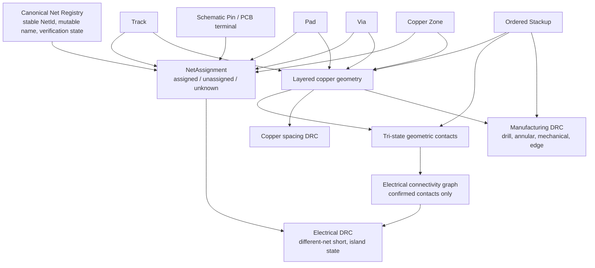
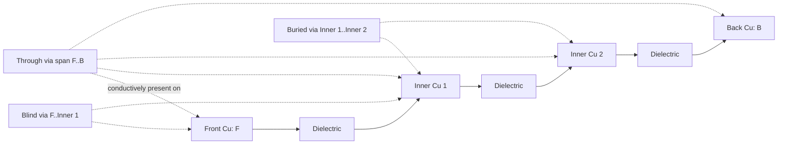

# PCB Studio Pro — Phase 6.0.1 DRC Data Model Architecture

**Status:** Design proposal only. No implementation is authorized or included. This document is outside the repository. It does not change the Phase 6 branch, source, tests, configuration, or UI.

## 1. Verified repository state and current-state summary

- Repository inspected: `/home/ubuntu/work/repo` (`soheil6913/-PCB-Studio-Pro`).
- Branch: `implementation/phase6-net-aware-drc-20261120`.
- Baseline and current `HEAD`: `6fad0dcdc7e5878e671b8b419b2f61084e5a8138`; baseline is an ancestor (in fact, current HEAD is exactly the baseline).
- Worktree: clean; no branch diff.
- `main`: `de7497a675af7c6212bbc4751fce098c1f414e8d`, unchanged.
- No branch switch, edit, test, commit, push, PR, merge, rebase, or cherry-pick occurred during this design phase.

### Current implementation findings (source references at the verified baseline)

1. **Project/object types:** `shared/engineering.ts:3–13`. `Layer` is only `"F.Cu" | "B.Cu"`; `EngineeringTrack.net?: string` and `EngineeringWire.net?: string` are optional string labels. Via, pad, pin and component types have no canonical net reference; no project Net or Copper Zone collection exists.
2. **Input validation:** `shared/engineering.ts:330–347`. Unknown fields are rejected; Track/Wire `net` is type-checked only as `string`, not resolved against a registry or normalized as an identity. A missing label is accepted; empty strings are not rejected by these checks. Via `layers` must contain exactly two distinct valid copper-layer values (`:343`).
3. **Schematic connectivity:** `shared/engineering.ts:269–284`; tests `shared/engineering.test.ts:67–93,149–154`. A geometric graph of wires, junctions and pins supports schematic unconnected/disconnected/conflicting-name findings. It is not a PCB copper graph and is not linked to Track/Pad/Via net assignments.
4. **PCB DRC paths:** `shared/engineering.ts:286–322`. Track-track (`:309`), Track-pad (`:318`), Pad-pad (`:319`), Track-via/Via-pad and single-via checks (`:320`), and Via-via (`:321`) use geometric distances and layer gates as applicable. None uses PCB net identity; the Via-via rule does not gate on `via.layers`.
5. **Via and manufacturing:** `shared/engineering.ts:320,343,346`. Existing independent per-via checks include drill geometry, minimum drill diameter, minimum annular ring, and board-edge clearance. No drill-to-drill or general pairwise mechanical rule was found. Pads may have drill/plated fields but have no pad minimum-drill or annular rule path in the audited validator.
6. **Layer-span tests:** `shared/phase5_1.geometry-validation.test.ts:359–389`; `shared/engineering.test.ts:156–175`; `shared/phase5_4.drc-boundary-semantics.test.ts:1312–1369`. Both orderings `F.Cu,B.Cu` and `B.Cu,F.Cu` are valid; singleton/duplicate/unknown spans are rejected. Missing span is explicitly unavailable/unknown, not a verified disjoint span.
7. **Prior policy audit:** `/home/ubuntu/work/PHASE_6_0_DATA_MODEL_POLICY_AUDIT.md`; Phase 5.5 limitations are also recorded in `PHASE_5_5_DRC_POLICY_CERTIFICATION.md:149–160`.

### Consequence

The approved policy goals are not fully executable against current documents. Same-net Track-Track comparisons could only use an unverified raw label; all other required copper object pairings lack net identity. A valid via span always denotes both available copper layers, so the current schema cannot encode two valid non-sharing spans. The architecture below adds those missing abstractions but does not claim they exist today.

## 2. Proposed design principles

- Separate **assignment**, **geometric contact**, **electrical connectivity**, and **manufacturing applicability**. A matching name or net ID alone never proves geometric or electrical connection.
- Use stable opaque IDs; never derive identity from a mutable display name.
- Preserve unknown/unassigned/invalid as explicit states. Missing, unresolved, stale or numerically uncertain data must not default to `CLEAR` or to same-net.
- Keep electrical DRC and manufacturing DRC as independent rule families over shared geometry inputs.
- Apply the same-net overlap exception only to the applicable copper-pair overlap/spacing finding for the exact pair. Never suppress checks against a third object, board edge, drill, mechanical keepout, connectivity, or numerical uncertainty.
- Keep layer IDs and net IDs separate from display names. Layer intersection is based on validated stackup positions and conductive span membership, not string equality.
- Keep unsupported objects (especially zones and microvias) explicitly unsupported until their geometry, data, persistence, and rules are defined and implemented.

## 3. Proposed data structures (illustrative TypeScript, not production code)

The interfaces below are a conceptual target. Exact API names, serialization shape, and migration version remain subject to review.

```ts
type NetId = string & { readonly __brand: "NetId" };
type LayerId = string & { readonly __brand: "LayerId" };
type CopperObjectId = string & { readonly __brand: "CopperObjectId" };

type NetIdentity = {
  id: NetId;                 // immutable, opaque UUID/ULID; never name-derived
  name: string;              // mutable display/canonical name
  state: "verified" | "unverified" | "deprecated";
  aliases?: string[];        // explicit only; alias does not create/merge identity
  source?: "user" | "schematic-import" | "legacy-migration";
};

type NetAssignment =
  | { state: "assigned"; netId: NetId }
  | { state: "unassigned" }
  | { state: "unknown"; reason: "legacy-unresolved" | "missing-reference" | "ambiguous-name" | "invalid-source" };

type CopperLayer = {
  id: LayerId;               // stable identity; independent of display label
  name: string;
  kind: "copper";
  order: number;             // strictly ordered physical copper position
  face: "front" | "back" | "internal";
  enabled: boolean;
};

type NonCopperLayer = {
  id: LayerId;
  name: string;
  kind: "dielectric" | "mask" | "silkscreen" | "paste" | "mechanical" | "other";
  order: number;
  enabled: boolean;
};
type StackupLayer = CopperLayer | NonCopperLayer;

type Stackup = {
  version: 1;
  layers: StackupLayer[];    // explicit physical order, unique IDs and order values
  frontCopperId: LayerId;
  backCopperId: LayerId;
};

type ViaSpan = {
  startCopperLayerId: LayerId;
  endCopperLayerId: LayerId;
  kind: "through" | "blind" | "buried" | "microvia" | "unknown";
  // Optional explicit manufacturing sequence for stacked/staggered microvia;
  // absent for ordinary continuous plated barrel spans.
  stages?: Array<{ from: LayerId; to: LayerId; process: "laser" | "mechanical" | "other" }>;
};

type ConnectivityState =
  | { state: "connected"; componentId: string }
  | { state: "disconnected"; componentId: string }
  | { state: "indeterminate"; reasons: string[] };

type ContactState = "contact" | "separated" | "indeterminate";

type ConnectionIntent = {
  objectA: CopperObjectId;
  objectB: CopperObjectId;
  intent: "connect" | "forbid-contact";
  source: "route" | "pad-entry" | "via-transition" | "zone-thermal" | "user";
};

type CopperZone = {
  id: CopperObjectId;
  net: NetAssignment;
  layerId: LayerId;
  outline: Polygon;
  fillState: "fresh" | "stale" | "missing";
  fillGeometry?: Polygon[];   // actual filled copper islands, not outline alone
  fillHash?: string;
  clearanceRuleId?: string;
  thermalConnections?: Array<{ padId: string; state: "required" | "forbidden" }>;
};
```

Tracks, pads, vias, pins, and zones should each carry `NetAssignment` (or an explicit pin/terminal assignment propagated to a pad through a stable reference). A pad must have a stable parent component/pad ID and optional explicit `pinRef`; pad number must not be used as a global identity. A Track’s current `net` text should be retained as a legacy/display value during migration, not silently promoted to `verified` identity.

CopperZone is only a proposed shape: its actual fill, islands, thermals, priorities, cutouts, and clearance behavior need separate domain design. It must not be introduced as a decorative outline that the DRC mistakes for filled copper.

### Net-name policy proposal

- `NetId` is generated independently (e.g. persisted UUIDv7/ULID) and remains stable across renames.
- Names are trimmed and normalized to Unicode NFC before validation. Proposed v1 policy: reject empty/control-character names; preserve display spelling; reject duplicate canonical names after the selected comparison normalization. Decide case sensitivity and locale-independent normalization before implementation.
- Renaming a net changes its name, not its ID. Aliases must be explicit and cannot merge identities. If an alias collides with another canonical name, reject or require manual resolution.
- Duplicate names never trigger automatic identity merge. Import collisions produce an ambiguity requiring user choice.
- A reference to a missing registry ID is invalid/incomplete and maps to `unknown`, never to an arbitrary or newly guessed net.
- `unassigned` means a valid object is intentionally not assigned. `unknown` means the system cannot safely determine assignment. These are not interchangeable.

## 4. Relationship diagrams

### Assignment, geometry, connectivity, and DRC are separate layers



### Conductive layer membership and via spans



## 5. Connectivity evaluation algorithm

Connectivity is derived from both assignment and geometry; do not infer one from the other.

### 5.1 Geometry/contact phase

1. Validate schema, registry references, stackup order, layer kinds, via spans, object geometry, zone fill freshness, and rule configuration. Invalid required inputs produce `INDETERMINATE` or a specific invalid-input error; never continue with a fake layer or inferred net.
2. Expand each copper object into its actual conductive shapes on explicit `LayerId`s:
   - Track: swept segment/width on its layer.
   - Pad: transformed copper shape on explicit pad layer set.
   - Via: annular copper/barrel participation for each copper layer in the validated span; pad/land copper as separately modeled where relevant.
   - Zone: current filled copper polygons/islands on its layer; outline-only, stale fill, or unknown thermal geometry is not confirmed contact geometry.
3. Broad-phase candidate pairs with a per-layer spatial index. Candidate pairs include track-track, track-pad, track-via, pad-via, via-via, track-zone, pad-zone, via-zone, zone-zone. No shared conductive layer means no copper contact candidate; it does not suppress drill/mechanical checks.
4. For each candidate, use an independent robust geometric predicate to produce `ContactState = contact | separated | indeterminate`. Equality is inclusive only when certified. Contact means actual copper sets intersect/touch under the declared contact tolerance; clearance remains a separate threshold predicate.
5. Add only certified conductive contacts to the electrical graph. Via barrel transitions connect its participating layer nodes; a missing/invalid span does not create a guessed transition. Zones connect only their actual filled islands and verified thermal/direct connections.

### 5.2 Assignment and short-circuit phase

For every certified same-layer copper contact:

```text
if contact == INDETERMINATE:
    emit PCB_GEOMETRY_INDETERMINATE; do not clear or merge graph components
else if contact == CONTACT:
    if either assignment == UNKNOWN or registry reference is invalid:
        emit PCB_NET_IDENTITY_INDETERMINATE; do not accept same-net
    else if both assignments are verified and netId differs:
        emit PCB_COPPER_SHORT_CIRCUIT (Error)
    else if both assignments are verified and netId is equal:
        record physical connectivity edge; overlap is allowed by same-net policy
    else:
        emit PCB_NET_IDENTITY_UNASSIGNED (Error/Warning per approved severity); no silent same-net exemption
```

A matching ID establishes intended assignment, not that distant copper is connected. A connection exists only through certified conductive contact and via spans. Therefore, disconnected copper islands with the same verified `NetId` remain distinct graph components and are not reported as connected merely because labels agree. A separate unconnected-island/net-completeness check should compare actual components with the net’s expected terminals/routes and return `INDETERMINATE` when expectations or required geometry are incomplete.

For pairwise spacing:

- Same verified net plus certified physical overlap/contact: allow the overlap for that exact pair under the approved policy. This exception may suppress only the applicable same-pair copper-spacing finding; it must not suppress contacts/shorts involving third objects, board edge, drill/mechanical rules, net-island diagnostics, or uncertainty findings.
- Same verified net without contact: run existing clearance threshold unchanged.
- Different verified nets without contact: run existing clearance threshold unchanged; below threshold remains a clearance violation, not automatically a short.
- Unknown/unassigned identity with contact: report identity/connectivity indeterminate or error; do not treat as same-net.
- Geometry uncertainty: `INDETERMINATE` propagates; no label can override it.

### 5.3 Pair matrix

| Pair | Geometry / layer condition | Electrical result |
|---|---|---|
| Track-Track | Same copper layer; swept shapes contact | Same verified net: connected/allowed merge; different verified nets: short; unknown: indeterminate/error. If separated, ordinary track clearance. |
| Track-Pad | Track layer is in pad conductive layer set; transformed pad and track shapes contact | Same as above; pad needs explicit NetAssignment and stable pin/pad relation if schematic intent is used. |
| Track-Via | Track layer belongs to validated via conductive span; track intersects via copper | Same as above; unknown via span cannot establish contact or no-contact. |
| Pad-Via | Pad layer intersects via conductive span and copper shapes contact | Same as above; independently run drill/annular/mechanical checks. |
| Via-Via | Valid span sets intersect and same-layer copper shapes contact | Same/different/unknown net handling as above; drill-to-drill check runs separately even where copper spans do not intersect if the drill rule applies. |
| Copper Zone interactions | Same layer and current filled copper, not merely overlapping outlines | Zone net assignment participates in short/connectivity checks. Unfilled/stale fill, thermal gaps, cutouts and isolated islands produce explicit incomplete/indeterminate outcomes. |

## 6. Ordered copper stackup and layer-intersection algorithm

### 6.1 Stackup requirements

- Stable `LayerId` is identity; names such as `F.Cu`, `In1.Cu`, `B.Cu` are labels/legacy aliases, not the comparison key.
- Store a total physical order and explicit layer `kind`; only enabled copper layers participate in copper span expansion.
- Require unique layer IDs, unique order positions, exactly one front copper and one back copper, and a consistent front-to-back order. Non-copper dielectric/mask/mechanical layers may occupy physical positions but never count as conductive copper.
- Stackup revision/hash is part of derived zone fill and connectivity cache identity.

### 6.2 Backward mapping

For existing two-layer documents, provision stable built-in IDs, e.g. `layer.front.copper` and `layer.back.copper`, mapped from legacy `F.Cu` and `B.Cu`. Keep a compatibility name map when reading old documents. Do not infer an internal layer or stackup order beyond those two known copper surfaces.

### 6.3 Span expansion and intersection

1. Resolve `startCopperLayerId` and `endCopperLayerId` in the stackup; both must be enabled copper layers.
2. Find their order indices `i0`, `i1`. The occupied copper-layer set for an ordinary plated barrel is all enabled copper layers with order index in `[min(i0,i1), max(i0,i1)]`, inclusive. Preserve ordered traversal for manufacturing metadata; set membership is used for intersection.
3. A via pair shares a copper layer iff `intersection(spanSetA, spanSetB).length > 0`.
4. `0` means no same-layer via copper-clearance comparison; it does not mean drill/mechanical clearance is absent.
5. Missing ID, non-copper endpoint, invalid ordering/stackup, unknown span kind, or incomplete stackup produces `UNKNOWN/INVALID`, not an empty set. An empty set is reserved for a valid, fully resolved disjoint span.
6. For future microvias, model individual fabrication stages and validate each stage as an allowed adjacent-layer transition. Do not represent a stacked or staggered microvia as one fictitious continuous barrel unless its process and electrical continuity are confirmed.

For the current two-layer legacy schema, every valid explicit span contains F and B, so no disjoint valid pair exists. The separate policy is meaningful only after stackup/span expansion supports a multilayer board or another valid disjoint conductive-layer representation.

## 7. Independent manufacturing rule families

Every family returns `CLEAR`, `VIOLATION`, or `INDETERMINATE`. Equality is `CLEAR` only when the geometric comparison certifies `actual >= required`; numeric uncertainty is `INDETERMINATE`, not a pass. Missing required geometry, unverified layer applicability, stale zone fill, or unknown stackup must never silently clear a rule.

| Rule family | Required inputs / applicability | Threshold semantics | Missing/unknown behavior |
|---|---|---|---|
| Copper-to-copper clearance | Filled/conductive copper geometry; validated copper-layer sets; applicable rule/class; NetAssignments only for approved same-net exception | For different nets or non-overlapping pairs: minimum surface-to-surface gap. Equality clear if certified; below threshold violation. Same-net contact exception only for that exact pair. | Unknown NetAssignment at contact prevents same-net exemption and emits identity indeterminate/error. Unknown layer set/geometry => indeterminate. |
| Drill-to-drill clearance | Hole centers, bore shapes/diameters, drill class/tolerance, physical Z/depth interval or an explicitly approved 2D conservative projection, relevant manufacturing rule | Minimum hole-edge separation; exact equality clear; below threshold violation. Evaluate whether hole paths overlap in physical depth according to the manufacturing rule. | Unknown hole shape, depth, stackup thickness, or rule applicability => indeterminate. Do not infer no conflict from non-shared copper layers. |
| Drill-to-copper clearance | Hole/bore geometry, copper shapes by layer, drill span/depth, plating and rule class | Distance from drill boundary to non-exempt copper; separate from plated annular-ring checks. Threshold applies to the appropriate traversed layers/depth. | Unknown drill span, plating, copper layer, or geometry => indeterminate. Do not infer clearance from a missing via copper span. |
| Annular ring | Plated hole center/bore shape and copper land/annulus shape for each applicable copper layer; min ring rule | Minimum radial/material ring width around bore. Equality clear when certified; below threshold violation. | Unplated/unknown plating or absent land geometry => inapplicable only if explicitly modeled; otherwise unknown/indeterminate. |
| Mechanical clearance | Mechanical keepout/object geometry, component/board envelope, rule class, Z interval if applicable | Minimum 2D or 3D gap as defined by the named rule. | No geometry or undefined dimensional semantics => indeterminate; cannot be inferred from copper clearance. |
| Board-edge manufacturing | Actual board-outline/cutout geometry, copper shape or drill/hole geometry, feature-specific edge rule and manufacturing tolerance | Distinct copper-to-edge, hole-to-edge, component-to-edge constraints. Equality clear if certified; less is violation. | Current rectangular board is insufficient for arbitrary outlines/cutouts; missing outline/feature dimensions => indeterminate. |

Rule results should use separate rule IDs and object IDs, e.g. copper short, copper clearance, drill spacing, annular ring, mechanical clearance, hole edge, copper edge. A no-common-copper-layer result suppresses only the same-layer via copper clearance rule; drill and mechanical checks remain independently evaluated.

## 8. Migration and compatibility strategy

### 8.1 Versioning and safety

- Introduce a new serialized schema version only after a migration contract and UI/API consumers are reviewed (current `CURRENT_PROJECT_VERSION` is 2; `shared/engineering.ts:23`).
- Migration is pure, deterministic and idempotent; validate migrated output before atomic save. Preserve original document bytes or a recoverable versioned backup. Provide rollback/export to original schema while the legacy representation can still be faithfully retained.
- Unsupported/invalid documents remain loadable only in a read-only or repair state with explicit diagnostics; do not drop fields or silently fabricate IDs, layer spans, or nets.
- Maintain a migration record containing source schema version, source hash, migration version and diagnostics; repeated load must not create new IDs each time.

### 8.2 Legacy `Track.net` strings

- Preserve each raw legacy string in an import/compatibility field until explicit resolution.
- Proposed import treatment: create candidate Net records with `state: "unverified"` for exact legacy labels and assign matching legacy track labels to the corresponding candidate NetId only as an *unverified assignment*. Do not infer electrical connectivity, does not auto-map schematic Wire labels to Tracks, and does not allow the same-net overlap exemption until the candidate is verified.
- Do not merge strings differing only in case/normalization. If normalization produces a duplicate/ambiguous candidate, quarantine the association for manual resolution. Empty/missing labels become explicit `unassigned` or `unknown` according to migration provenance; do not assign a default GND or any other Net.
- Once confirmed, store immutable IDs; display-name rename never changes identity.

### 8.3 Existing two-layer projects and vias

- Map legacy `F.Cu`/`B.Cu` to fixed stable front/back copper LayerIds in a two-copper stackup.
- Existing explicit `["F.Cu","B.Cu"]` or reversed spans map to the same ordered full-stack span after validating representation; retain original order in migration metadata if needed.
- Existing missing `via.layers` remains unknown span. Do not promote absence to through-via or disjoint. Require user confirmation or retain incomplete status for rules that depend on the span.
- Existing drill/diameter values and minimum-drill/annular design rules are preserved as independent manufacturing inputs.

### 8.4 Pads, pins and UI/workspace compatibility

- Do not derive NetId from pad number, component reference, pin name, schematic label, or editor-generated wire string.
- Add explicit pad-to-pin and PCB-object NetAssignment only after the object IDs and workflow for assigning/confirming nets are designed. Keep old UI able to read names through a compatibility adapter; do not silently write a v3 project back in lossy v2 form.
- Workspace import/export, autosave, schema migration, undo/redo, and server-side validation must be included in a later compatibility phase. This proposal does not alter those systems.

## 9. Backward compatibility risks and alternatives

| Design choice | Recommended approach | Alternative / risk |
|---|---|---|
| Net identity | Immutable opaque NetId plus mutable name | Name as ID: rename changes identity; duplicate/alias labels merge or split unexpectedly. Not recommended. |
| Legacy labels | Import as unverified candidate assignments, preserving raw label | Auto-verify same strings: violates “matching text is not proof” and can suppress shorts. Per-object new nets: avoids merges but destroys intended group labels; only acceptable as a temporary repair mode with original labels preserved. |
| Unknown identity | First-class `unknown` state and Error/Indeterminate result | Treat missing as same-net or clear: unsafe and explicitly prohibited. Treat missing as different-net: may report false shorts; still preferable only as a fail-closed diagnostic, not as verified fact. |
| Layer comparison | Stable LayerId and ordered stackup | String checks: fragile aliases/order; cannot model inner layers robustly. |
| Via spans | Explicit endpoint IDs + validated ordered stack interval | Extend current `[Layer,Layer]` tuple: insufficient for arbitrary stackups, vias, staged microvias, and unknown vs empty semantics. |
| Zones | Filled geometry plus assignment/fill status | Outline-only zone: false contact and connectivity; do not implement. |
| Same-net overlap | Exact-pair exception when both verified assignments and contact are certified | Globally skip same-net clearance rules: can hide close unrelated same-net objects and other-object interactions. |
| Unknown connectivity | INDETERMINATE + actionable diagnostics | Treat graph not finding contact as disconnected/clear: unsafe when geometry/fill/spans are incomplete. |

### Compatibility risks

- All existing documents are schema version 2 or legacy/unspecified and have no Net registry. A naive migration could silently convert labels to trusted identities.
- Existing UI locally creates arbitrary schematic wire labels; those labels currently are not validated references to a net table.
- Current schema validation rejects unknown fields, so mixed old/new payloads will fail unless version-aware parsers/adapters are deliberately introduced.
- Old clients may erase new IDs/stackup properties on save; server/client version negotiation and round-trip tests are required.
- Existing DRC classifications can change when same-net pairs are exempted or when short-circuit errors are added; existing Phase 5 equality/uncertainty behavior must remain intact for unrelated pairs.
- A multilayer stackup changes schema, serialization, editor constraints, rendering, and possibly fabrication assumptions; it is not a test-only validator change.

## 10. Performance and complexity

- Naive pair generation is O(N²) per primitive family and can dominate projects. Use per-layer R-tree/sweep broad-phase candidate generation; expected O(N log N + K), where K is candidate pairs, but worst case remains O(N²) for dense overlap.
- Exact/numerically bounded narrow-phase geometry applies only to broad-phase candidates. Cache by object geometry revision, relevant rule inputs, layer set, stackup hash, and zone fill hash.
- DSU connected components over confirmed contacts is O(V + E α(V)); preserve edge provenance so a short/connectivity finding reports actual object paths and not only a component number.
- Via spans expand to L copper layers, so work is proportional to participating layers; index copper geometry per layer. A stackup with many layers increases candidate storage but avoids all-pairs across nonshared layers.
- Copper zone fill can be costly; cache only deterministic filled geometry keyed by outline, keepouts, priorities, thermal config, stackup and fill-engine version. A stale/failed fill invalidates connectivity/short certainty.
- Incremental editing should invalidate only affected spatial tiles/net components, but correctness must be compared to a full recomputation in tests.
- Unknown/indeterminate results should be sparse and scoped to implicated objects; do not allow a single unknown object to mark the entire board clear or to silently merge all graph nodes.

## 11. Phased implementation roadmap (proposal only)

| Stage | Scope | Gate / exit criteria |
|---|---|---|
| 6.0.1 | This architecture and current-state audit | Product/engineering review of decisions below; no source change. |
| 6.0.2 | Approve schema, name semantics, UI assignment flow, stackup/minimum manufacturing policy | Signed decisions for NetId, legacy migration, unknown severity, stackup, via kinds, drill applicability, zone scope. |
| 6.1a | Introduce versioned registry/assignments and safe migration adapters | Round-trip legacy data; unknown/unverified retained; no overlap semantics changed yet. |
| 6.1b | Add pad/pin mapping and PCB connectivity graph for Tracks/Pads/Vias; do not add zones until zone model is separately approved | Independent contact oracle; missing/incomplete input always indeterminate; baseline DRC regressions pass. |
| 6.1c | Add different-net contact/short reporting and narrow same-net contact exception | All pair matrix cases and unrelated-rule non-suppression proven; explicit unknown identity cases. |
| 6.2a | Add ordered stackup and via-span migration/validation | Valid through/blind/buried interval tests; unknown vs disjoint distinction; F/B compatibility. |
| 6.2b | Gate via-via copper clearance by validated span intersection; preserve independent drill/annular/mechanical rules | Shared/no-shared/unknown span tests where schema supports them; no invented layer cases. |
| 6.3 | Design/implement CopperZone fill, islands, thermals and connectivity as a separate feature if approved | Actual fill geometry, stale-fill behavior and zone-net policy independently verified. |
| 6.4 | Full regression, performance, CI, migration and compatibility sign-off | Test/check/build/CI success; no unresolved case called passing; documented deployment/rollback. |

The sequence is intentionally gated; do not begin 6.1a/6.2a until Stage 6.0.2 receives explicit approval. Zones and microvias can be deferred rather than approximated.

## 12. Test strategy

### Independent geometric and graph tests

- Build test-only exact or bounded oracles independent from production geometry functions. Use rational/integer geometry for axis-aligned and fixed-grid cases; use outward-bounded calculations for rotated shapes; preserve `INDETERMINATE` when intervals straddle thresholds.
- For each pair (Track-Track, Track-Pad, Track-Via, Pad-Via, Via-Via, each Zone pairing): same verified Net contact; different verified Net contact; same Net separation below/equal/above clearance; different Net separation below/equal/above; unknown/unassigned references; layer nonintersection; malformed geometry/span; numerical uncertainty.
- Test geometric contact and electrical connectedness independently: disconnected islands on same Net; same-layer contacts; contact through a valid via span; absent span; different-net touching/overlap short; disconnected net-assigned geometry remains disconnected; missing pin/pad mapping is indeterminate.
- Test exact equality semantics and preserve existing Phase 5.1–5.5 cases, including `PCB_GEOMETRY_INDETERMINATE`. Test same-net exception does not suppress unrelated checks against a third net/object, board edge, drill, annular ring, connectivity, or mechanical keepout.
- Metamorphic transforms: translation, reflection, rotation, uniform scaling with all rules scaled, endpoint reversal, stackup ID/name changes that preserve IDs/order, span reversal, serialization round trip, and input object order permutation.

### Migration tests

- v2 round trips; missing/empty/duplicate/unknown legacy net strings; exact duplicate label groups remain unverified; names differing by case/Unicode normalization are not silently merged; deterministic ID creation and idempotent rerun; invalid object references; missing span preserved as unknown; two-layer mapping; rollback to preserved source; old client read/write rejection or safe adapter behavior.

### Manufacturing tests

- Drill-drill and drill-copper only after rule definitions exist; through/blind/buried paths and physical depth; board-edge hole vs copper edge; annular equality/below/above; plated/nonplated; unknown stackup; independent outcomes when copper no-common-layer gate skips only copper clearance.

### Classification/reporting

- In an implementation phase, keep TP, TN, FP, FN and unresolved counts separate for each fixture ledger. Cases unsupported by current/approved schema are labeled unsupported, not passed. Unknown-policy or numerical-interval cases remain unresolved until specifically adjudicated.

No tests were run or changed for this design-only deliverable, so there is no Phase 6.0.1 fixture classification or implementation pass claim.

## 13. Open product and architecture decisions

1. Are Net names case-sensitive? Which Unicode normalization and whitespace rules apply? Are duplicate names disallowed globally or allowed with explicit namespaces?
2. What constitutes `verified` assignment: user confirmation, schematic compiler netlist, import from an authoritative source, connectivity validation, or a combination? Is `unverified` a warning, blocking error, or project-state blocker?
3. How does a schematic Pin map to a footprint Pad (explicit pin reference; component library mapping; stable pad key)? How are unconnected or unassigned pins represented?
4. Does any same-net copper contact automatically represent an intentional merge, or is explicit merge intent/connection metadata required? Should same-net but disconnected islands be a warning or an error, and under what completion state?
5. Are same-net clearances exempt only for physically connected/overlapping pairs, or do named same-net clearance overrides exist? Confirm exact-pair behavior and severity.
6. Should different verified-net contact always emit one short-circuit finding even if several objects overlap? Define finding deduplication, severities, and object attribution.
7. Which copper zone features are in scope: outlines, fill, cutouts, keepouts, priorities, thermal relief, island removal, and fill freshness? Is fill geometry serialized or deterministically recomputed?
8. What stackup fields are mandatory (dielectric thickness, copper thickness, material, impedance)? The via intersection needs ordering; drill/mechanical Z tests may require physical thicknesses.
9. Which via types are supported initially? Are through, blind, buried and laser microvias distinct process types? Are stacked/staggered microvias permitted? What is the authoritative definition of drill path and plated copper participation?
10. What does `minimumViaClearance` currently mean for non-overlapping spans—copper only, or also hole/mechanical spacing? Preserve as copper-only and create separate rules, or retain a legacy mapping?
11. Define drill-to-drill, drill-to-copper, mechanical and board-edge rules, rule classes, tolerances, Z applicability, net exceptions (if any), and exact equality semantics.
12. What severity and user remediation should apply to unknown Net IDs, unassigned copper overlap, missing span, stale zone fill, invalid stackup, and numerically indeterminate contact?
13. Which application/client versions must read/write the new schema concurrently? Define server validation and downgrade/rollback expectations.

## 14. Explicit blockers and unsupported scenarios

- Current model cannot provide verified PCB NetIds for pads/vias/pins/zones or a PCB connectivity graph; same-net policy is not ready for implementation.
- Current schema cannot express any valid pair of vias with no shared conductive layer; the approved separate-layer policy cannot be behaviorally implemented/tested until a stackup/span model exists.
- Copper Zones, zone filling, thermal joins and zone connectivity are unsupported.
- Blind/buried/microvias, internal copper layers, physical Z span, drill-to-drill, drill-to-copper and mechanical keepouts are unsupported in the audited baseline.
- Existing per-via minimum drill and annular-ring checks can remain separate from copper clearance, but do not satisfy the broader independent manufacturing rule families in the request.
- No migration code or compatibility adapter is implemented by this document. Legacy string handling described here is a proposal only.

## 15. Approval gate

This proposal is not an authorization to implement. Before any Phase 6.1 or 6.2 code change, obtain explicit approval of the Net registry/assignment contract, connectivity and merge semantics, stackup/via representation, migration rules, unknown-result behavior, and manufacturing rule scope. Any product decisions not resolved above must remain explicitly pending. Stop rather than fabricate Net identity, layer spans, zone fill, or via capabilities.
